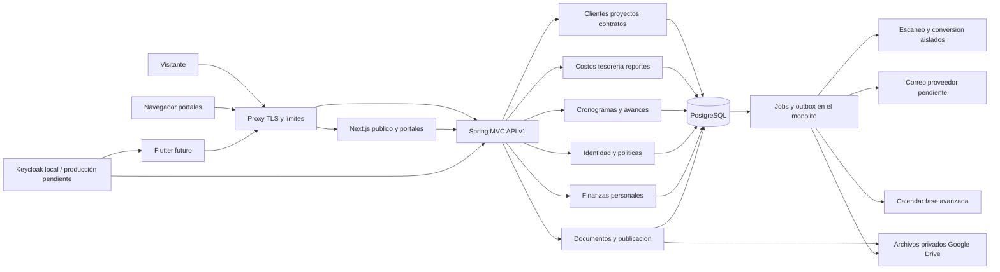

# 04 — Arquitectura técnica

Actualización 27/10/2026: [ADR 0017](adr/0017-altas-y-aprobacion-de-cuentas.md) conserva el stack y añade un adaptador HTTP al Keycloak existente para altas/activación. Next.js queda en **16.4.3**, parche de seguridad de la misma rama; lockfile actualiza fast-uri **3.1.9** y Zod **4.6.7** (transitivas). Licencias MIT/BSD-3-Clause y peers Node/React verificados; sin dependencias nuevas ni cambios del BOM Java. Resultados y límites actuales en [25](25-altas-y-aprobacion-de-cuentas.md); las versiones de entregas históricas conservan su fecha.

[Índice](README.md) · [Datos](05-modelo-de-datos.md) · [API](06-api-y-openapi.md) · [ADR](adr/README.md)

## Decisiones confirmadas y diseño propuesto

Confirmado para M0: Java **27**, Boot **4.2.0-M2** aceptada tras fallar el parent final 4.2.0, Maven, MVC/Security/JPA/Validation/Flyway, PostgreSQL y monolito modular con frontend desacoplado. Fundamentos, módulos empresariales M1 y operación financiera M2 implementados y probados localmente; M3 también está implementado según [20](20-entrega-m3.md); M4 implementado localmente según [21](21-entrega-m4.md), con exposición pendiente; M5–M6 pendientes. [Entrega M2](19-entrega-m2.md). [Entrega M1](17-entrega-m1.md). [ADR 0009](adr/0009-fundamentos-ejecutables-m0.md), [versiones/evidencia](16-entrega-m0.md). No hay necesidad demostrada de microservicios, bus distribuido, Redis, WebSocket o Kubernetes. El starter WebSocket existente no implica un requisito de tiempo real; refresco e invalidación de TanStack Query bastan inicialmente.

Propuesto: conservar backend Maven en raíz; `frontend/` como aplicación Next.js; módulos por dominio y contratos explícitos dentro del mismo proceso. REST es la frontera para Next.js y Flutter. Next.js puede renderizar contenido y componer vistas, pero no aprueba dinero, calcula saldos oficiales, valida DAG ni persiste entidades empresariales.

Es un diagrama conceptual, no infraestructura desplegada. El worker puede ejecutar en el proceso inicial con límites; separar el proceso de conversión/escaner cuando su carga o aislamiento lo requiera, conservando los contratos. No hay escritura de una integración en la transacción JDBC.

## Módulos y responsabilidades

| Paquete conceptual | Propiedad y casos de uso | Dependencias permitidas |
|---|---|---|
| `identity` | Identidades OIDC, roles, invitaciones, membresías, políticas y grants | `shared` |
| `parties` | Clientes/proveedores/organizaciones/contactos/categorías | `identity`, `shared` |
| `projects` | Ficha, estado, miembros, ubicación y cierre coordinado | `parties`, `identity`; puertos de lectura del resto para cierre |
| `contracts` | Contrato, enmiendas, solicitud y aprobación del extra | `projects` por contrato de consulta, `identity` |
| `procurement` | Versiones de cotización, aprobación y compromiso de proveedor | `projects`, `parties`, `contracts` |
| `costs` | Gastos, reconocimiento, imputaciones, créditos y consumo de compromiso | Puertos de `projects`, `procurement`, `documents` |
| `treasury` | Reportes de depósito, caja, movimientos confirmados, cobros/pagos/imputaciones/reversiones | `projects`, `contracts`, `costs` mediante APIs internas |
| `scheduling` | Cronograma, tareas, DAG, pesos, avances verificados y revisión de alcance | `projects`, `parties`; referencia de extra por ID |
| `documents` | Metadatos, vínculos, audiencias, cuarentena, XML fiscal y almacenamiento | `identity`, puertos de autorización del recurso; sin leer todos los repositorios |
| `reporting` | Proyecciones financieras por obra y globales, snapshots y PDF | APIs de lectura `contracts`, `costs`, `treasury`, `procurement`; política GERENTE |
| `personalfinance` | Ámbito personal, cuentas, categorías y movimientos aislados | `identity`, `documents` con ámbito personal; nunca repositorios empresariales |
| `reconciliation` | Adaptadores bancarios, propuestas/vínculos y correcciones | `treasury`, `documents`; personal por interfaz separada y autorización propia |
| `publication` | Fichas públicas, consentimientos y variantes aprobadas | `projects` opcional, `documents`; DTO públicos específicos |
| `integrations` | Conexiones OAuth, mappings Calendar, notificaciones/reintentos | Eventos/outbox de `scheduling`; `identity`; sin modificar saldos |
| `audit`, `shared` | Auditoría, reloj, IDs, Money/errores, outbox/idempotencia | Sin convertirse en repositorio universal de reglas |

Las dependencias de la tabla son contratos de aplicación, no acceso libre a entidades JPA. `documents` pregunta a un `ResourceAuthorizationPort`; el módulo propietario lo implementa. Cierre usa un orquestador que consulta puertos y bloquea la obra sin introducir `projects↔reporting` como dependencias de implementación. Comprobar límites con pruebas de arquitectura; no añadir Spring Modulith/ArchUnit hasta evaluar si la estructura básica lo requiere.

Dentro de cada módulo: `api` (DTO/HTTP), `application` (casos de uso/transacciones), `domain` (reglas), `infrastructure` (JPA/servicios externos). Evitar capas vacías o interfaces de una sola clase sin motivo: el límite más importante es el módulo y la frontera del servicio externo.

## Consistencia y procesos

- Una aprobación monetaria se ejecuta en transacción local con bloqueo/versionado del agregado, autorización, registro de idempotencia y auditoría. Error de cualquiera revierte el conjunto.
- Outbox en PostgreSQL para acciones externas durables; consumidores idempotentes, lease y reintentos. Eventos internos identificados por UUID y versión; entrega al menos una vez, no prometer exactly-once.
- Proyecciones de saldo se calculan desde hechos autorizados o se materializan con revisión verificable; ningún cliente manda un “balance final”. Lecturas financieras con corte consistente; cache se invalida después del commit.
- Archivos y DB no tienen transacción distribuida: reserva/quarantena→escaneo→vínculo activo, con compensación y limpieza de objetos huérfanos. Eventos no publican objetos pendientes.
- Cronograma se modifica como agregado con versión común para fechas, jerarquía, dependencias y pesos; validación Spring y no solo SVAR.

## Autenticación M0 y clientes futuros

OIDC/OAuth 2.0 con Keycloak local seleccionado; P-02 pendiente solo para producción. MFA desactivado por decisión del usuario; contraseña y reautenticación reciente para operaciones sensibles. Spring funciona como cliente OIDC para navegador y resource server para Flutter. Navegador accede a `/api/v1` y `/auth` mediante proxy en el mismo origen, cookie de sesión `Secure`, `HttpOnly`, `SameSite=Lax` y CSRF en mutaciones; no se guardan bearer/refresh tokens en `localStorage`. La cookie web no se envía al cliente Flutter.

Flutter utilizará Authorization Code + PKCE con navegador del sistema y almacenamiento seguro; recibe access tokens con audiencia API. El modo bearer es stateless y se distingue explícitamente de sesión: una petición autenticada por cookie nunca queda exenta de CSRF porque también se admita OAuth bearer. Roles y recursos son de ATO, no del calendario de Google. Normas actuales de seguridad de OAuth: [RFC 9700](https://www.rfc-editor.org/rfc/rfc9700.html). Configuración local en BK-005/ADR 0006; no escribir un servidor de identidad casero en el MVP.

Next SSR consume Spring con contexto autorizado por petición, sin cache compartida ni forwarding indiscriminado de cabeceras. No duplica sesiones en un BFF con permisos propios. Si después se necesita BFF, documentar cookies, tokens y revocación en un ADR.

## Dependencias: comprobación al 7 de octubre de 2026

La siguiente tabla conserva la evaluación de selección inicial. La combinación fijada y ejecutada en M0 (Boot 4.2.0-M2, Node 24.21.0, Next 16.4.0/React 19.3.0, PostgreSQL 18.6 y Keycloak 26.8.0), licencias y build/E2E se registran en [16](16-entrega-m0.md). Evitar rangos `latest` en imágenes/CI y overrides de versiones gestionadas por el BOM de Spring sin evidencia.

| Tecnología | Evidencia/compatibilidad actual | Licencia y conclusión |
|---|---|---|
| Java 27 / Boot 4.2.0-M2 | Preview aceptada para M0, parent resuelto y build/arranque probado. 4.2.0 final no se resolvió al intentarlo; revalidar versión estable antes de producción | [Boot línea 4.2](https://docs.spring.io/spring-boot/4.2/system-requirements.html), [Boot Apache-2.0](https://github.com/spring-projects/spring-boot/blob/main/LICENSE.txt). Distribución JDK/licencia y soporte final se verifican antes de liberar |
| Maven | Wrapper apunta 3.9.16; Boot requiere Maven ≥3.6.3 | [Apache-2.0](https://github.com/apache/maven/blob/master/LICENSE); rango compatible por documentación de Boot; wrapper 3.9.16 ejecutado en M0 |
| Spring Security / Data JPA | Mantener versiones gestionadas por Boot y probar sesión/bearer/ORM en JDK 27; no overrides aislados | [Security Apache-2.0](https://github.com/spring-projects/spring-security/blob/main/LICENSE.txt), [Data JPA Apache-2.0](https://github.com/spring-projects/spring-data-jpa/blob/main/LICENSE.txt) |
| Hibernate ORM / Validator | Dependencias transitivas de JPA/Validation; validar la versión efectivamente resuelta, no inferir compatibilidad 27 solo del starter | Las ramas actuales consultadas declaran [ORM Apache-2.0](https://github.com/hibernate/hibernate-orm/blob/main/LICENSE.txt) y [Validator Apache-2.0](https://github.com/hibernate/hibernate-validator/blob/main/license.txt). La licencia de una rama actual no sustituye revisar el artifact/versión del BOM final |
| Next.js / React | App Router actual incluye cambios de React 19; mínimo Node 20.9. Propuesta Node **24 LTS**, no mínimo obsoleto; fijar Next/React estables juntos | [Instalación Next](https://nextjs.org/docs/app/getting-started/installation), [Node soporte](https://nodejs.org/en/about/previous-releases), [Next MIT](https://github.com/vercel/next.js/blob/canary/license.md), [React MIT](https://github.com/react/react/blob/main/LICENSE) |
| TypeScript | Modo estricto, versión que soporte el Next seleccionado | [Apache-2.0](https://github.com/microsoft/TypeScript/blob/main/LICENSE.txt); versiones gestionadas en frontend, fijada en 5.9.3 en M0 |
| Tailwind CSS / shadcn/ui | Propuesta Tailwind 4 y componentes compatibles con React 19; controlar estilos globales al integrar SVAR | [Tailwind MIT](https://github.com/tailwindlabs/tailwindcss/blob/main/LICENSE), [shadcn MIT](https://github.com/shadcn-ui/ui/blob/main/LICENSE.md), [compatibilidad React 19](https://ui.shadcn.com/docs/react-19) |
| Motion | Usar paquete `motion`, Client Components y desmontaje correcto; confirmar SSR/React elegido | [Instalación oficial](https://motion.dev/docs/react-installation), [core MIT](https://github.com/motiondivision/motion/blob/main/LICENSE.md); no presupone productos comerciales Motion+ |
| GSAP | Opcional para landing si Motion/CSS no bastan; carga por ruta, cleanup y reduced motion | [Licencia estándar propia sin cargo](https://gsap.com/community/standard-license/) permite uso comercial pero tiene restricciones para editores visuales de animación. No describir como MIT |
| TanStack Query | v5 declara React ≥18; cache por identidad y consulta | [Instalación](https://tanstack.com/query/latest/docs/framework/react/installation), [MIT](https://github.com/TanStack/query/blob/main/LICENSE), [releases mantenidas](https://github.com/TanStack/query/releases) |
| SVAR React Gantt | Community `@svar-ui/react-gantt`; declara React ≥18; probar React 19/Next Client Component | [Paquetes/licencia](https://docs.svar.dev/react/gantt/getting-started/installation/), [manifest actual](https://github.com/svar-widgets/react-gantt/blob/main/package.json). MIT Community; PRO comercial. [Detalle funcional](09-gantt-y-planificacion.md) |
| springdoc-openapi | Línea 3.x para Boot 4; actual 3.1.1. Matriz consultada enumera 4.0.x, no demuestra 4.2.0 + Java 27 | [Matriz oficial](https://springdoc.org/), [proyecto Apache-2.0](https://github.com/springdoc/springdoc-openapi); prueba específica antes de adoptar |
| Flyway Community | Usar versión gestionada por Boot más `flyway-database-postgresql`; verificar versión PostgreSQL y JDK 27 | [Core Apache-2.0](https://github.com/flyway/flyway/blob/main/LICENSE.txt), [releases](https://github.com/flyway/flyway/releases). No depender de capacidades Teams/Enterprise |
| PostgreSQL | Propuesta línea 18 mantenida; fijar minor soportado después de ensayar driver/Flyway. No `postgres:latest` | [Política de soporte](https://www.postgresql.org/support/versioning/), [licencia PostgreSQL](https://www.postgresql.org/about/licence/) |
| Driver pgJDBC | Versión gestionada por Boot; ensayar numeric, timestamps, conexiones y locking en Java 27 | [BSD de dos cláusulas](https://github.com/pgjdbc/pgjdbc/blob/master/LICENSE); no confundir con la licencia del servidor PostgreSQL |
| Google Drive / Google Auth | Drive API v3, originales binarios con revisión fijada y hash; biblioteca Google Auth Java 1.54.0. Sustituye el SDK S3 por instrucción del usuario | [Autenticación oficial](https://docs.cloud.google.com/java/getting-started/getting-started-with-google-auth-library), BSD-3-Clause según el POM oficial del artifact; [configuración y evidencia](18-almacenamiento-google-drive.md) |
| MinIO Community | Repositorio oficial archivado el 25-04-2026, declara que no se mantiene; no base recomendada de producción | [Estado oficial y AGPLv3](https://github.com/minio/minio). Evaluar servicio S3 mantenido o producto con soporte, licencias/costos en P-11 |

Los rangos declarados no sustituyen pruebas. M0 sí ejecutó la combinación fijada: detalle en 16. La preview fue aceptada explícitamente; una release estable se revisará antes de producción. Springdoc no está instalado: se sirve el contrato estático versionado (ADR 0009).

## Evaluación de tablas y gráficos

| Alternativa | Adecuación y costo técnico | Recomendación |
|---|---|---|
| TanStack Table (9.2.6 seleccionada en M0) | Headless, control de paginación/filtros en servidor, composición shadcn; requiere implementar semántica de tabla y móvil. Documentación/versiones activas; React según adapter final | Propuesta MVP; [instalación](https://tanstack.com/table/latest/docs/installation), [MIT](https://github.com/TanStack/table/blob/main/LICENSE), [releases](https://github.com/TanStack/table/releases) |
| Tabla HTML/shadcn simple | Menor complejidad para listas pequeñas; no introduce un grid completo ni filtros masivos | Usar antes de Table cuando basta; no tratar shadcn como motor de datos |
| Recharts 3 | Gráficos React/SVG de barras y tendencias apropiados para decenas/centenas de puntos; manifiesto admite React 19 y `react-is` compatible. Añadir descripción y tabla alternativa | Propuesta MVP; [MIT](https://github.com/recharts/recharts/blob/main/LICENSE), [peers](https://github.com/recharts/recharts/blob/main/package.json), [releases](https://github.com/recharts/recharts/releases) |
| Apache ECharts | Canvas/SVG para series densas y visuales complejos, integración React manual con lifecycle; más configuración/bundle | Alternativa futura si mediciones lo justifican; [Apache-2.0](https://github.com/apache/echarts/blob/master/LICENSE) y documentación del proyecto |

No se recomienda un grid comercial mientras no haya necesidad concreta. No cargar todos los gastos para paginar en el navegador. Volúmenes supuestos para pruebas y puertas de calidad en [12](12-pruebas-y-calidad.md).

## Consecuencias

Un único deploy backend y transacciones locales simplifican integridad y soporte; un fallo del proceso afecta varios módulos, mitigado con observabilidad, backups y jobs acotados. La separación de API/DTO facilita Flutter y reduce exposición, a costa de mantener contratos y generación de clientes. Google Drive conserva los binarios fuera de PostgreSQL, pero exige restauración coordinada de IDs/revisiones/hashes y control de permisos heredados. [ADRs iniciales](adr/README.md) distinguen estas propuestas de los límites ya aceptados.

## Implementación M1

Módulos `parties/projects/contracts/documents` con JDBC explícito y transacciones de servicio sobre el BOM confirmado, sin cambiar stack ni estructura. El adaptador S3 inicial fue sustituido por Google Drive (ADR 0011); se conservan ClamAV independiente y parser JVM con límites. Pruebas de protocolo Drive locales; cuenta Google real pendiente. [ADR 0010](adr/0010-obras-contratos-evidencias-m1.md) documenta decisiones, alternativas, contratos y límites; versiones/licencias/avisos en [17](17-entrega-m1.md).

## Incremento M2 implementado

`finance` centraliza política de obra/evidencia/precisión y locks; `costs` implementa propuestas, revisiones, imputaciones y reconocimientos; `treasury`, movimientos/efectos y aplicaciones; `documents.fiscal`, bundle local y parser en JVM hija; `reporting`, consultas agrupadas/cortes y DTO por audiencia. Continúa JDBC/servicios transaccionales del monolito M0/M1, sin dependencias ni cambios de stack. [ADR 0012](adr/0012-operacion-financiera-y-xml-m2.md) · [entrega](19-entrega-m2.md).

## Incremento M4 implementado

`publication` usa DTO públicos, contenido aprobado, variantes privadas y consentimiento por imagen; `integrations.mail` entrega notificaciones mínimas Gmail con cola tipada y lease. Se conserva el monolito/BOM y Drive, sin proveedor nuevo de archivos. Hosting local + Tunnel seleccionado, sin exposición realizada. [ADR 0014](adr/0014-publicacion-contacto-operacion-m4.md) documenta decisiones/alternativas; [21](21-entrega-m4.md) registra ensayos y [22](22-operacion-m4.md), gates de operación.
