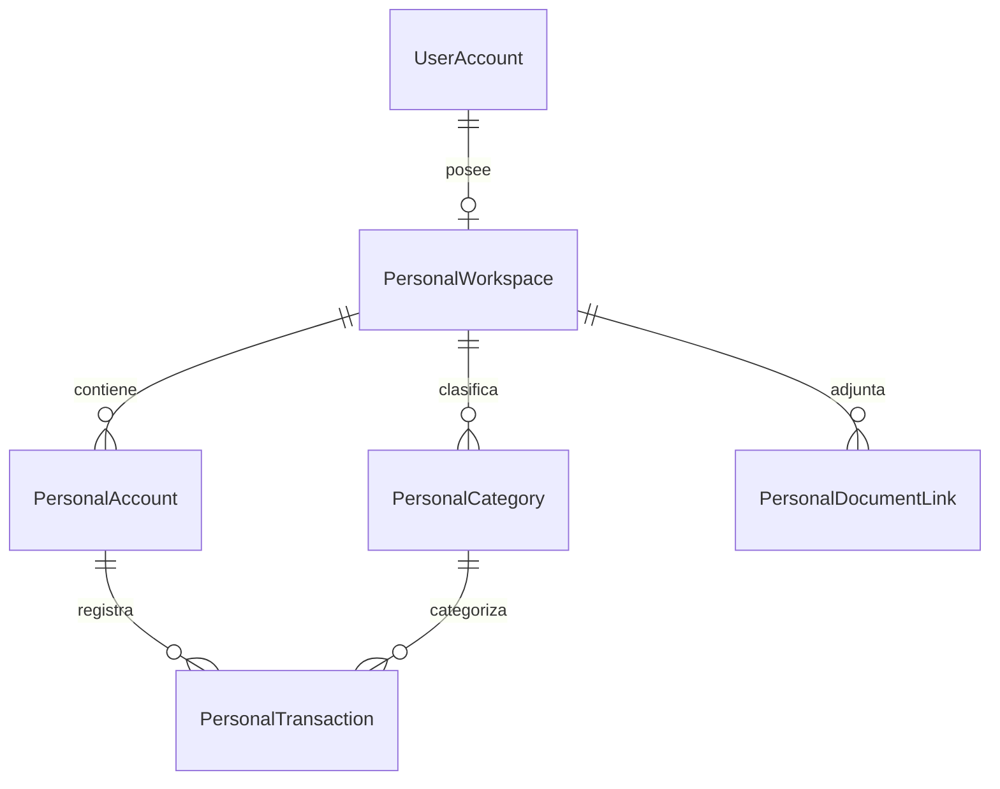

# 05 — Modelo conceptual de datos

Cartera V11: `party.supplier_category` enum controlado solo SUPPLIER, con CHECK/índice. Proveedores anteriores pasan a OTHER sin cambiar `category` libre, versión ni membresías; clientes conservan valor nulo. No requiere vínculo a proyecto. [Detalle](26-reprogramacion-y-proveedores.md).

Identidad V10: `user_account` agrega `access_state`, `access_version`, `email_verified`, `decided_by/at` y `decision_note`; `account_activation` conserva estado/intentos/lease/error/envío sin credenciales ni enlaces. Cuentas antiguas con roles quedan aprobadas y las demás pendientes; habilitación/membresías se conservan. [Semántica y límites](25-altas-y-aprobacion-de-cuentas.md).

[Índice](README.md) · [Finanzas](08-reglas-financieras.md) · [Cronograma](09-gantt-y-planificacion.md) · [API](06-api-y-openapi.md)

Estado: M0–M4 implementados para desarrollo local, con evidencia en [16](16-entrega-m0.md), [17](17-entrega-m1.md), [19](19-entrega-m2.md), [20](20-entrega-m3.md) y [21](21-entrega-m4.md). Aceptación productiva pendiente; M5–M6 siguen planificados.

**Modelo empresarial incremental.** M0 incluye migraciones de identidad, auditoría, idempotencia, jobs y recursos sintéticos; M1 añade el SQL de cartera, obras, contratos, extras, documentos y privacidad. El ER muestra agregados y vínculos esenciales; los atributos y restricciones siguientes completan el modelo. No todos los agregados se implementan en el MVP. El sistema es de una empresa, con ámbito personal reservado, no un SaaS multiempresa.

## ER empresarial

```mermaid
erDiagram
    UserAccount ||--o{ UserRole : tiene
    UserAccount ||--o{ ProjectMember : participa
    Client ||--o{ ClientMember : representa
    UserAccount ||--o{ ClientMember : representa
    Supplier ||--o{ SupplierMember : representa
    UserAccount ||--o{ SupplierMember : representa
    Client ||--o{ Project : contrata
    Project ||--o{ ProjectMember : autoriza
    Project ||--|| Contract : base
    Contract ||--o{ ContractAmendment : modifica
    Project ||--o{ ExtraRequest : solicita
    ExtraRequest ||--o{ ExtraRevision : versiona
    ExtraRevision ||--o| ContractAmendment : formaliza
    Project ||--o{ Quote : recibe
    Supplier ||--o{ Quote : presenta
    ExtraRequest o|--o{ Quote : origina
    Quote ||--|{ QuoteRevision : versiona
    QuoteRevision ||--o| Commitment : aprueba
    Commitment ||--o{ CommitmentConsumption : reconoce
    Project ||--o{ ExpenseAllocation : recibe
    Expense ||--|{ ExpenseAllocation : imputa
    Supplier o|--o{ Expense : emite
    FiscalVoucher o|--o{ Expense : evidencia
    ExpenseAllocation ||--o{ CostRecognition : valida
    CostRecognition ||--o{ CommitmentConsumption : consume
    Project ||--o{ DepositReport : reporta
    DepositReport ||--o{ DepositConfirmation : vincula
    TreasuryMovement ||--o{ DepositConfirmation : demuestra
    TreasuryMovement ||--o{ CollectionAllocation : cobra
    Project ||--o{ CollectionAllocation : recibe
    TreasuryMovement ||--o{ PaymentAllocation : paga
    ExpenseAllocation o|--o{ PaymentAllocation : liquida
    Commitment o|--o{ SupplierAdvanceAllocation : anticipa
    TreasuryMovement ||--o{ SupplierAdvanceAllocation : entrega
    BankAccount o|--o{ TreasuryMovement : aloja
    BankAccount ||--o{ StatementImport : importa
    StatementImport ||--o{ BankLine : normaliza
    BankLine ||--o{ ReconciliationLink : concilia
    TreasuryMovement ||--o{ ReconciliationLink : verifica
    Project ||--o{ BudgetRevision : presupuesta
    BudgetRevision ||--|{ BudgetLine : desglosa
    Project ||--|| Schedule : planifica
    Schedule ||--o{ Task : contiene
    Task ||--o{ TaskDependency : enlaza
    Task ||--o{ TaskAssignment : asigna
    Supplier ||--o{ TaskAssignment : ejecuta
    Task ||--o{ ProgressReport : reporta
    Schedule ||--o{ ProgressBaseline : pondera
    ProgressBaseline ||--|{ TaskWeight : pesa
    Project ||--o{ ClosureSnapshot : cierra
    Document ||--o{ DocumentLink : adjunta
    FiscalVoucher ||--|{ FiscalVoucherLine : desglosa
    Document ||--o| FiscalVoucher : contiene
    PublicProject o|--o{ PublishedAsset : publica
    PublicationConsent ||--o{ PublishedAsset : autoriza
    Document ||--o{ PublishedAsset : deriva
    UserAccount ||--o{ SupportGrant : recibe
```

`Contract`, `Schedule` se crean al activar la obra; en borrador pueden faltar (el ER expresa el estado operativo). `TaskDependency` tiene FK a predecesora y sucesora; `TaskWeight` a baseline y tarea hoja/hito; las relaciones omitidas para legibilidad se especifican abajo. Auditoría y documentos usan referencias tipadas validadas, no FK que permita un ID sin contexto.

## Identidad, contactos y proyectos

| Entidad | Atributos principales y validación |
|---|---|
| `UserAccount` / `UserRole` | UUID, `issuer` + `subject` únicos, correo verificado de contacto, estado, roles, versión. No guardar contraseña si IdP la gestiona; correo no es identidad inmutable |
| `UserAccount.display_name` | Nombre privado de presentación obtenido del perfil OIDC autenticado; puede estar vacío en cuentas anteriores. No identifica ni concede permisos; fallback por correo |
| `Client`, `Supplier`, `PartyContact` | Tipo persona/organización, nombre comercial/legal, identificación cuando necesaria, contactos, zona, categorías y estado. No duplicar nombre personal del PDF; no exigir cédula para contactar públicamente |
| `ClientMember`, `SupplierMember` | Usuario/parte, estado, capacidad de representante, otorgador, vigencia. Único vínculo activo por usuario/parte; pertenecer a una parte no autoriza todas sus tareas indiscriminadamente |
| `ProjectMember` / `ProjectAssignment` | Usuario o proveedor, proyecto, tipo CLIENT/OPERATIONS/SUPPLIER, capacidades, vigencia y revocación. La parte y el proyecto deben coincidir |
| `Project` | UUID, código visible único, cliente principal, ubicación privada, coordenadas opcionales, contacto, fechas civiles, estado, versión y creator. `estimatedEnd` no reemplaza fecha contractual comprometida |
| `Contract` | Proyecto único, número de contrato y revisión, fecha de firma/evidencia, moneda contractual, importe base bruto, impuestos desglosados y estado |
| `ContractAmendment` | Contrato, revisión, delta firmado de monto/plazo, motivo, extra/revisión opcional, evidencia de aceptación y formalizador. Una enmienda efectiva no se sobreescribe |
| `ExtraRequest` / `ExtraRevision` | Origen, alcance solicitado; versiones de alcance, precio al cliente, moneda, impacto de plazo, estado y evidencia. Precio cliente separado de costo de proveedor; solo una versión efectiva por extra |

La relación con clientes se desactiva, no se elimina si tiene contrato. Cambiar contratante después de activar exige enmienda/proceso documentado y revisión de acceso, no un PATCH libre.

## Costos, compromisos y tesorería

| Entidad | Atributos principales / frontera |
|---|---|
| `Quote`, `QuoteRevision`, `QuoteLine` | Proyecto/proveedor/extra opcional; revisión, origen, vigencia, moneda, líneas, impuestos, condiciones, documento y estados. Unique `(quoteId, revision)` |
| `Commitment` | Revisión aprobada única, proyecto/proveedor, monto bruto/neto, moneda, modificaciones/reversiones y estado. No equivale a pago |
| `BudgetRevision`, `BudgetLine` | Proyecto, versión aprobada, moneda/base fiscal, partidas e importes. Compromisos/gastos referencian partida para comparar sin sumar presupuesto y compromiso |
| `Expense`, `ExpenseAllocation` | Comprobante/origen, emisor/proveedor, fechas, categoría, importes con precisión, moneda; asignaciones a proyecto/extra/partida con proporción/importes e impuestos. Varios proyectos pueden compartir una factura sin copiar su total |
| `CostRecognition` | Asignación, evento VALIDATE/CREDIT/REVERSAL, importe firmado en moneda/tasa original, autor, instante y vínculo al anterior. Solo este stream produce costo validado neto |
| `CommitmentConsumption` | Compromiso + reconocimiento + importe; distribuye consumo con suma acotada, no cuenta nuevamente el costo. No consumir por pago o anticipo |
| `DepositReport` | Proyecto, actor, monto/moneda, fecha operación, medio/referencia, evidencia, estados/reportes de revisión y versión. El reporte no es un movimiento de caja |
| `DepositConfirmation` | Reporte y movimiento; importe enlazado, confirmador y reversión. Varios reportes pueden enlazar al mismo movimiento bajo límites; no generan varios cobros |
| `TreasuryMovement` | UUID, ámbito BUSINESS, cuenta/caja, dirección IN/OUT, tipo RECEIPT/PAYMENT/REFUND/TRANSFER/FUNDING/COMMISSION, monto positivo, moneda, fecha operación/valor, estado confirmado, referencia y reversión. Dirección determina signo; correcciones mediante eventos vinculados |
| `CollectionAllocation` | Movimiento, obra/contrato/extra opcional, porción en moneda original y contractual, tasa, propósito COBRO/DEVOLUCION/EXCESO, reversión. Única imputación lógica por movimiento/contrato/propósito/idempotencia |
| `PaymentAllocation` | Movimiento OUT/IN de devolución, obra, asignación de gasto, importe aplicado y conversión; enlace a anticipo previo si se liquida sin nueva salida de caja |
| `SupplierAdvanceAllocation` | Movimiento y compromiso/proveedor/obra, monto del anticipo, aplicaciones posteriores a gasto y devolución. Vincular a gasto mueve aplicación, **no crea otro movimiento** |
| `ExchangeRateSnapshot` | Par, dirección `CRC por USD`, tasa positiva, fuente, instante/fecha efectiva, motivo, responsable, estrategia de redondeo. Inmutable, usado por asignaciones; no corregir cifras históricas al actualizar una tasa |

Un solo `TreasuryMovement` puede contener imputaciones a varias obras; las sumas en su moneda no superan su importe, con residual explícito. Un pago y gasto pueden no coincidir por impuestos, anticipo, parcialidad o varios proyectos. No usar relación 1:1 factura-pago. Las restricciones de suma entre filas requieren transacción/bloqueo además de checks por fila.

## Bancos y cronogramas

`BankAccount` y `CashAccount`: moneda, ámbito y acceso reservado; números completos cifrados/enmascarados. `StatementImport`: documento/hash/cuenta, versión de adaptador y estado. `BankLine`: ID externo cuando exista, fechas, importe/moneda, referencia, huella y raw locator. `ReconciliationLink`: línea, movimiento, importe aplicado, aprobador, estado y corrección. No inferir ID externo de una línea PDF si no existe. [Contrato de adapters](10-documentos-e-integraciones.md).

`Schedule`: proyecto, revisión de datos y calendario, estado/versión. `Task`: proyecto/schedule, parent opcional, tipo LEAF/SUMMARY/MILESTONE, intervalo `[start,end)`, progreso verificado, estado, extra opcional, versión. `TaskDependency`: predecesora/sucesora, tipo FS inicial, lag y unidad, único enlace tipado, sin self-link. `TaskAssignment`: tarea/proveedor y vigencia; múltiples asignaciones no multiplican peso. `ProgressReport`: autor, avance propuesto/evidencia, avance aprobado y verificador. `ProgressBaseline`, `TaskWeight`: revisión/alcance aprobado, pesos exactos de hojas/hitos y explicación de cambio. [Reglas](09-gantt-y-planificacion.md).

## Documentos, publicación y tareas de sistema

`Document`: UUID, ámbito BUSINESS/PERSONAL, object key aleatoria, hash SHA-256, tamaño, MIME detectado/declarado, nombre original sanitizado, uploader, estado de cuarentena/escaneo, retention class, fecha, versión de objeto y clasificación. Contenido fuera de PostgreSQL. `DocumentLink`: clase de recurso, ID, proyecto/titular cuando aplica y audiencia; solo allowlist de tipos; validar existencia/ámbito transaccionalmente. `FiscalVoucher`: clave/tipo/versión/namespace, emisor/receptor, fecha original/UTC, moneda, tasa fiscal, totales, referencia a original para NC/ND y estados de validación estructural/firma/mensaje Hacienda separados. Guardar valores originales 4.4, líneas/impuestos y diagnóstico; PDF no suplanta XML.

`PublicProject`: slug, contenido aprobado, servicios, fecha/año opcional, ubicación general, link opcional a proyecto interno, estado editorial. `PublicationConsent`: recurso/material, alcance/medio, titular/representante referenciado, evidencia, vigencia/revocación. `PublishedAsset`: consentimiento, documento original privado y variante sin EXIF para distribución pública; publicación y finanzas jamás comparten DTO.

`ClosureSnapshot`: obra, revisión, corte, versión de fórmulas, importes por moneda, pendientes/excepciones, referencia/hash de resumen; inmutable. `SupportGrant`: solicitante ADMIN, otorgador GERENTE, ámbito/recursos/campos/acciones, propósito y expiración/revocación. `AuditEvent`: actor real, sesión/grant de soporte, recurso, acción, instante, motivo, valores mínimos protegidos, before/after version y traceId.

`IdempotencyRecord`: sujeto/ámbito/operación/key, hash de petición, respuesta/estado y vigencia; unicidad en transacción. `OutboxEvent`: agregado/revisión, payload mínimo, fecha, attempts y estado. `Job`: propósito, estado, lease, error sanitizado y actor/ámbito; reválida autorización en ejecución y entrega. `CalendarConnection`/`CalendarMapping`: titular/scopes/calendarId/tokens cifrados, tarea/revisión/eventId únicos y estado sync. `ContactRequest`: datos mínimos de respuesta, mensaje sanitizado, aviso aceptado y estado; fuera de cuentas empresariales.

## Ámbito personal separado

`PersonalWorkspace.ownerUserId` exige GERENTE; tablas en esquema propuesto `personal`, sin FK a Project/Expense/TreasuryMovement empresarial. `PersonalTransaction`: ingreso/gasto/transferencia, importe/moneda, fecha, cuenta/categoría propias, evidencia privada y reversión. La transferencia de propietario a empresa usa una referencia opaca común en dos registros autorizados, sin consultas cruzadas automáticas. Aislamiento lógico no sustituye controlar roles DB/claves/backups. No dar al rol de soporte de base de datos `SELECT` irrestricto a ese esquema por defecto.

## Restricciones, índices y migraciones

- UUID generado en servidor como ID; códigos visibles únicos. Versionado optimista en agregados y bloqueo del padre para sumas/DAG; registrar instante UTC y actor en cambios críticos. Mutaciones monetarias y de cronograma comparten guard de Project con cierre, en orden de locks fijo; no comprobar CERRADO fuera de la transacción y escribir después.
- Dinero `numeric(24,5)` propuesto para valores fiscales originales y cálculos; valores liquidados en escala de moneda (CRC/USD 2 como política propuesta), pesos/tasas `numeric(24,10)`. Validar overflow y no aplicar formato de display sobre datos fuente.
- FKs para referencias estables, `ON DELETE RESTRICT` conceptual sobre datos financieros; unique clave fiscal + emisor/tipo según bundle validado, quote revisión, enmienda efectiva de extra, import por cuenta/hash y mapping Calendar. Archivos repetidos con hash coincidente no sustituyen unicidad fiscal.
- Índices de acceso: `(project_id, state, operation_date, id)` en reportes/gastos, `(supplier_id, project_id)` en assignments/quotes, `(user_id, project_id, active)` en miembros, `(contract_id, effective_at)` en enmiendas, `(account_id, operation_date, external_id)` en banco, `(schedule_id, predecessor_id/successor_id)` en dependencias, `(resource_type, resource_id, created_at)` en auditoría, `(owner_id, date, id)` en personal, `(state, next_attempt_at)` en jobs.
- Restricciones de suma, alcance y ciclo no se delegan a `CHECK`: caso de uso transaccional, pruebas y reconciliación de integridad. Los índices se confirman con planes de ejecución y datos realistas, sin indexar indiscriminadamente payloads personales.
- Flyway: migraciones inmutables, baseline solo para DB conocida, `validate` antes de deploy y `ddl-auto=validate`. Añadir columnas/índices de forma compatible, backfill verificable, luego constraints y retirada futura. Restauración en vez de SQL destructivo de rollback de dinero; migration repair solo tras investigación.
- En esta entrega **no hay scripts SQL, modelos JPA ni creación de esquemas**. Los nombres son contratos conceptuales para preparar las tareas del backlog.

## Modelo implementado M1

[V3](../src/main/resources/db/migration/V3__m1_projects_contracts_documents.sql) añade `party/party_member`, `project/project_member`, `contract/contract_amendment`, `extra_request/extra_revision/extra_acceptance`, `document/document_link/document_hold`, `privacy_notice/publication_consent/privacy_request`. [V4](../src/main/resources/db/migration/V4__m1_protect_privacy_history.sql) protege avisos aprobados y condiciones de consentimiento. No modifica V1/V2 ni convierte recursos sintéticos en obras. FK/constraints, numeric(20,2), moneda CRC, fechas civiles, instante efectivo, locks y unicidad de enmienda por revisión; base/enmiendas/revisiones/aceptaciones conservadas. [Evidencia de actualización](../src/test/java/com/daraya/atoconstrucciones/M1MigrationTests.java).

## Almacenamiento Drive, actualización posterior de M1

V5 agrega `document.storage_provider`: S3 para filas anteriores, GOOGLE_DRIVE para nuevas reservas. `drive_storage_object` liga key lógica, carpeta/fileId, nombre, tipo, tamaño/SHA-256 y revisión fijada. Su reserva sobrevive rollback del comando documental para evitar duplicados remotos; no tiene FK a document por esa razón. Mantiene metadatos técnicos internos, no expone fileId al portal. No se reinterpretan object_version existentes ni se modifican V1–V4. [Decisión y migración](18-almacenamiento-google-drive.md).

## Modelo físico M2

[V6](../src/main/resources/db/migration/V6__m2_financial_operations.sql) incorpora `treasury_account`, `treasury_movement`, `treasury_effect`, `deposit_report`, `collection_application`, `payment_application`, `expense`, `expense_revision`, `expense_allocation`, `cost_recognition`, `fiscal_voucher`, `fiscal_voucher_document` y `financial_state_event`. `allocation_revision` selecciona la propuesta vigente sin eliminar imputaciones anteriores. NC/ND vinculan el gasto original y sus hechos se agrupan en la obligación para calcular deuda/crédito sin duplicar costo.

Unicidad de factura por clave; identidad de caja confirmada por cuenta/`fact_key`; precisiones numéricas, estados, FK e índices. Fuentes confirmadas y hechos/revisiones protegidos contra alteración/borrado/TRUNCATE. Aplicaciones y notas están acotadas bajo locks de servicio; no se presentan estas sumas agregadas como simples CHECK de fila. Upgrade/restore probados con PostgreSQL 18.6, sin modificar V1–V5. [Estado, pruebas y límites](19-entrega-m2.md).

## Persistencia implementada M3

[V7](../src/main/resources/db/migration/V7__m3_schedule_and_progress.sql) amplía V1–V6. `schedule` tiene revisión global; `schedule_task` conserva tipo/extra/identidad y progreso verificado. `task_assignment` y `task_dependency` mantienen asignaciones y FS; FK compuesta impide padres/dependencias entre obras. `progress_report`/`progress_verification`, `progress_baseline`/`task_weight`/`progress_baseline_approval` y `schedule_revision` son inmutables y rechazan UPDATE/DELETE/TRUNCATE. La revisión guarda grafo/propuestas/reportes y proyección cliente al corte. [Entrega](20-entrega-m3.md).

## Implementación M4

V8 expansiva agrega `public_site_content`, `publication`, `published_asset`, `publication_revision`, `document_variant`, `contact_request`, `contact_delivery`, `contact_rate_limit` y `contact_access_delegate`. Variante inmutable fija key/revisión/hash/tamaño/dimensiones; asset conserva consentimiento y foto de origen. Ficha `project_id` nullable permite portafolio sin crear historial financiero. Publicación no cambia estado contractual. Contacto anónimo usa key/body hashes propios sin cuenta visitante; solicitud y delivery se guardan juntos. Consentimientos y avisos conservan V3/V4. [Migración](../src/main/resources/db/migration/V8__m4_publication_contact.sql), [ADR](adr/0014-publicacion-contacto-operacion-m4.md).

## Cuentas legibles, actualización de M4

[V9](../src/main/resources/db/migration/V9__account_display_names.sql) agrega `user_account.display_name varchar(200) NOT NULL DEFAULT ''`. Conserva identidades, roles, habilitación, invitaciones y membresías. El login actualiza el nombre si el perfil lo proporciona, sin reemplazar un nombre previo por uno vacío ni habilitar cuentas revocadas. Upgrade V8→V9 y restauración cifrada de DB/ACL/nombres/invitaciones comprobados con datos sintéticos. [Entrega](23-cuentas-y-accesos.md).
